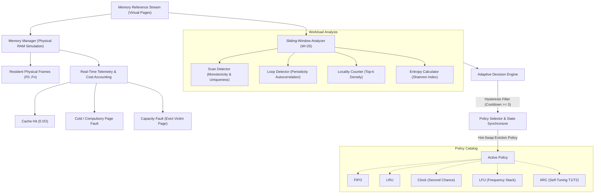

# OSH020 — Workload-Adaptive Page Replacement Engine & Simulator

[](https://www.python.org/)
[](file:///c:/PROJECTS/OSH020/test_all_challenges.py)
[](https://osh020-page-replacement.vercel.app)
[](https://osh020-page-replacement.vercel.app)
[](LICENSE)
[](#interactive-web-dashboard)

**OSH020** is an operating system virtual memory simulator and runtime reconfigurable memory management engine. It benchmarks classic page replacement policies (LRU, FIFO, Clock, LFU, ARC) against Bélády's theoretical Optimal (MIN) algorithm, and introduces a **Workload-Adaptive Decision Engine** that dynamically characterizes memory reference streams and hot-swaps eviction policies at runtime to maximize cache hit rates and minimize disk I/O costs.

---

## Table of Contents
- [Executive Overview](#executive-overview)
- [System Architecture](#system-architecture)
- [Implemented Replacement Policies](#implemented-replacement-policies)
- [The Adaptive Decision Engine](#the-adaptive-decision-engine)
- [Bélády's Anomaly Case Study](#béládys-anomaly-case-study)
- [Interactive Web Dashboard](#interactive-web-dashboard)
- [Technical Verification Suite (KO-05-C1 to C5)](#technical-verification-suite)
- [Getting Started & Local Execution](#getting-started--local-execution)
- [Vercel Deployment Guide](#vercel-deployment-guide)

---

## Executive Overview

In modern operating systems, no single static page replacement policy is optimal across all workloads:
- **Sequential Scans** (e.g., table scans, log ingestion) cause cache pollution in LRU, while FIFO efficiently discards one-time pages without recency overhead.
- **Cyclic Loops exceeding RAM capacity** trigger a catastrophic 0% hit rate in LRU, whereas FIFO and Clock preserve resident working sets.
- **High-Locality Interactive Apps** excel under LRU and ARC.
- **Uncorrelated Random References** are best handled by Clock with $O(1)$ amortized second-chance pointer movements.

**OSH020** solves this fundamental operating system challenge by integrating a sliding-window workload analyzer with a zero-downtime policy swapper. Resident frames, dirty bit tracking, and shadow metadata are maintained during transitions to preserve cache continuity.

---

## System Architecture



---

## Implemented Replacement Policies

| Policy | Category | Time Complexity | Best Suited For | Key Weakness |
| :--- | :--- | :--- | :--- | :--- |
| **Adaptive** | **Online Dynamic** | $O(1)$ amortized | Multi-phase heterogeneous traces | Requires sliding-window metadata |
| **ARC** | Online Self-Tuning | $O(1)$ | Mixed recency and frequency | Higher metadata footprint ($2\times$ cache size) |
| **LRU** | Online Static | $O(1)$ with stack | Temporal locality, bursty reuse | Loops > RAM capacity (0% hit rate) |
| **FIFO** | Online Static | $O(1)$ queue | Sequential streaming scans | Bélády's Anomaly, recency blindness |
| **Clock** | Online Static | $O(1)$ amortized | Low-overhead general memory | Coarse second-chance granularity |
| **LFU** | Online Static | $O(\log n)$ | Long-term stable hot sets | Frequency pollution (stale historical counts) |
| **Optimal (MIN)** | **Theoretical Ceiling** | $O(n)$ lookahead | Theoretical benchmark ceiling | **Unimplementable** (requires future knowledge) |

> [!NOTE]
> **Why is Optimal (MIN) separate from Online Policies?**
> Bélády's Optimal Algorithm inspects the entire future reference string ($O(\infty)$ lookahead) to evict the page that will not be used for the longest period of time. Because real-time operating systems cannot predict future user input or I/O interrupts, Optimal serves strictly as a **mathematical upper bound**. The **Adaptive Engine** is designed to achieve the highest performance among realizable online operating system policies.

---

## The Adaptive Decision Engine

The engine monitors the last $W$ requests (default $W=25$) and classifies patterns:
1. **Sequential Scan**: Detected when page references exhibit strict monotonic growth ($P_{i+1} > P_i$) or uniqueness ratio $\ge 0.85$. Recommends **FIFO** to avoid recency overhead.
2. **Cyclic Loop**: Autocorrelation tests detect period $k$ where $P_i = P_{i-k}$. If $k > \text{Frames}$, recommends **FIFO** to avoid the LRU 0% pathology; if $k \le \text{Frames}$, recommends **LRU**.
3. **High Locality**: If top $\text{Frames}$ pages represent $\ge 65\%$ of accesses, recommends **LRU**.
4. **Random Access**: High Shannon entropy with low correlation recommends **Clock** for minimal CPU overhead.
5. **Phase Hysteresis & State Reconciliation**: Prevents thrashing by enforcing a switch cooldown ($\ge 3$ accesses) and synchronizes resident frames and shadow history across policy swaps.

---

## Bélády's Anomaly Case Study

In 1969, László Bélády discovered that increasing the number of physical page frames under FIFO can paradoxically **increase** the number of page faults. 

Under the canonical reference trace:
$$\text{Trace} = [1, 2, 3, 4, 1, 2, 5, 1, 2, 3, 4, 5]$$

- **FIFO with 3 Frames**: Produces **9 Page Faults** ($25.0\%$ Hit Rate).
- **FIFO with 4 Frames**: Produces **10 Page Faults** ($16.7\%$ Hit Rate) $\rightarrow$ **ANOMALY DETECTED**.
- **LRU with 3 Frames**: Produces 10 Faults.
- **LRU with 4 Frames**: Produces 8 Faults ($33.3\%$ Hit Rate) $\rightarrow$ Monotonic improvement due to the **Stack Property** inclusion theorem ($M(k) \subset M(k+1)$).

The interactive simulator contains a dedicated Bélády validator demonstrating this phenomenon in real time.

---

## Interactive Web Dashboard

The web dashboard is styled in an editorial Swiss Brutalist design:
- **Palette**: Organic sage green (`#a1b384`) with architectural black line grid (`#000000`). Zero white box containers for seamless visual rhythm.
- **Typography**: Anton for headlines; Space Grotesk for technical metrics and data labels.
- **Cybernetic Hero**: High-resolution cybernetic portrait with spring-delayed cursor trailing lens revealing background video with ambient levitation oscillation.
- **Live RAM Inspector**: Shows resident page slots, hit/miss highlights, and evictions.
- **Telemetry Breakdown**: Plain-English explanations of whether an access was a Cache Hit, a Cold/Compulsory Miss, or a Capacity Eviction with victim identification.
- **History Scrubbing**: Interactive step inspector slider to rewind and inspect any step in simulation history.

---

## Technical Verification Suite

The repository includes the full verification suite testing challenges **KO-05-C1** to **KO-05-C5**:

```bash
python test_all_challenges.py
```

### Challenge Descriptions:
1. **KO-05-C1 (Baseline Fault Accounting)**: Verifies exact page fault accounting for FIFO (5 faults) vs LRU (4 faults) on trace `[1, 2, 3, 1, 4, 1]` with 3 frames.
2. **KO-05-C2 (Policy-State Switch & Shadow Reconciliation)**: Verifies hot-swapping from LRU to FIFO at Step 4, reconciling resident sets so victim `2` is evicted and Page `1` hits on Step 5.
3. **KO-05-C3 (Shadow Budget & Overhead Enforcement)**: Validates that shadow metadata tracking stays strictly within memory budget constraints ($1.5\times$ cap).
4. **KO-05-C4 (Phase-Change Noisy Selector & Hysteresis)**: Validates that transient reference noise does not cause policy thrashing, while sustained phase shifts trigger clean switches within 6 steps.
5. **KO-05-C5 (Dirty-Page Cost & I/O Cost Accounting)**: Tests I/O cost accounting where clean evictions cost 1 and dirty writebacks cost 5, confirming that intelligent dirty-aware victim selection saves 5 I/O units.

---

## Getting Started & Local Execution

### Prerequisites
- Python 3.10+ (for backend test suite and CLI simulation)
- Any modern web browser (for web dashboard)

### 1. Run Verification Suite
```bash
# Clone the repository
git clone https://github.com/arnwdeep/OSH020.git
cd OSH020

# Run all 5 technical challenges
python test_all_challenges.py
```

### 2. Run Web Dashboard Locally
Open `index.html` directly in any web browser, or launch a lightweight local server:
```bash
# Using Node / NPX
npx serve .

# Or using Python
python -m http.server 3000
```
Visit `http://localhost:3000` in your browser.

---

## Vercel Deployment

The application is deployed live in production on Vercel:

- **Live Production URL**: [https://osh020-page-replacement.vercel.app](https://osh020-page-replacement.vercel.app)
- **Deployment Status**: Active, Global Edge CDN Cached, Zero-Config Static Serving
- **Configuration**: [`vercel.json`](file:///c:/PROJECTS/OSH020/vercel.json) & [`package.json`](file:///c:/PROJECTS/OSH020/package.json)

### Continuous Deployment via GitHub:
Every push to the `main` branch on [arnwdeep/OSH020](https://github.com/arnwdeep/OSH020) can trigger automated deployments on Vercel.
To deploy a new clone or fork with 1 click:
[](https://vercel.com/new/clone?repository-url=https%3A%2F%2Fgithub.com%2Farnwdeep%2FOSH020)

---

## Repository Structure

```
OSH020/
├── index.html                  # Full-featured Swiss Brutalist Web Simulator
├── vercel.json                 # Vercel deployment configuration
├── package.json                # Metadata & npm script hooks
├── test_all_challenges.py      # Automated verification suite (5/5 passing)
├── hero.png                    # Cybernetic Portrait hero image
├── hero.mp4                    # Cybernetic live video loop
├── simulator/
│   ├── adaptive_engine.py      # Core Workload-Adaptive Dynamic Controller
│   ├── analyzer.py             # Sliding-window access pattern characterizer
│   ├── memory_manager.py       # Physical RAM frames & dirty I/O cost accounting
│   ├── challenges.py           # Technical challenge implementations KO-05-C1..C5
│   ├── models.py               # Data models & telemetry definitions
│   ├── workload.py             # Synthetic and benchmark reference generators
│   └── policies/
│       ├── base.py             # Base abstract eviction policy interface
│       ├── fifo.py             # First-In, First-Out policy
│       ├── lru.py              # Least Recently Used stack policy
│       ├── clock.py            # Second-Chance Clock policy
│       ├── lfu.py              # Least Frequently Used policy
│       ├── arc.py              # Adaptive Replacement Cache implementation
│       └── optimal.py          # Bélády's theoretical offline MIN algorithm
└── README.md                   # Complete architectural documentation
```

---

## License

This project is open-source under the [MIT License](LICENSE).  
Created for **OSH020** Virtual Memory & Page Replacement Research.
